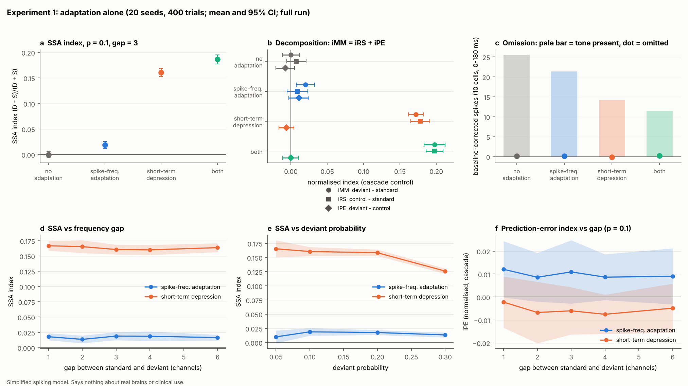
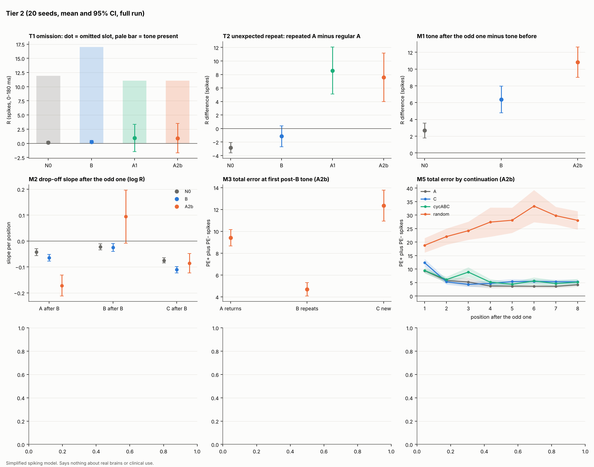

# snn-oddball

A small, reproducible comparison of **stimulus adaptation** and **prediction-error mechanisms** in a spiking neural
network, using auditory-style oddball sequences.

> **This is a simplified model.** It says nothing about real brains and nothing about clinical use. It is a careful
> replication and comparison of ideas that already have a substantial literature, not a claim of novelty. One mechanism
> ("A") is my own hypothesis, tested here as *a variant I am testing*; whether it is already in the
> literature has not been established (see `docs/PRIOR_ART.md`).

**Paper:** [`paper/paper.md`](paper/paper.md) (PDF: [`paper/paper.pdf`](paper/paper.pdf)) is the write-up of everything below.

**Status:** Experiment 1 (adaptation alone), the Tier 2 experiments and a slow-adaptation sensitivity check are complete with 20 seeds. Nothing below
is claimed beyond what the tables show; several pre-registered predictions were not supported and are reported as such.

## The question
1. **Experiment 1:** what does adaptation alone explain (spike-frequency adaptation, short-term depression)? Using the
   standard oddball plus the many-standards and cascade controls, the deviant-minus-standard difference splits into
   repetition suppression (control minus standard) and a prediction-error component (deviant minus control).
2. **Experiment 2:** what is the smallest mechanism that must be added to adaptation to produce a response to a
   **missing tone** (omission) and to an **unexpected repeat** in an alternating sequence (A B A B A A)? The
   candidates: the slow predictive core B (a simplified predictive-coding network *in the spirit of* Wacongne, Changeux &
   Dehaene 2012, **not** a faithful replication), and my proposed mechanism A (A1, A2b).

## Setup
Python 3.11+ (developed on 3.13). Versions are pinned in `requirements.txt` (Brian2 2.10.1, NumPy 2.5.4,
SciPy 1.18.1, Matplotlib 3.11.2, pytest 9.1.1).
```bash
make setup           # creates .venv, installs pinned dependencies and the package
make test            # unit tests (about 3 minutes)
```

## Reproduce each figure (one command per figure)
| Command | What it runs | Time |
|---|---|---|
| `make fig1-quick` | Experiment 1, 5 seeds, 120 trials, reduced sweeps | about 10 min on 4 cores |
| `make fig1` | Experiment 1, 20 seeds, 400 trials | hours (resumable) |
| `make fig2-quick` | Experiment 2 and the Tier 2 suites, 5 seeds, short sequences | about 1 hour on 4 cores |
| `make fig2` | The same with 20 seeds | many hours (resumable) |
| `make quick-all` | tests plus both quick runs | |

Runs are cached in `results/raw/` (git-ignored) and resume after an interruption. Every random draw is seeded, so a
re-run reproduces identical numbers. Figures and tables go to `results/`.

## Model in brief
- **Input:** 10 tone channels, each driving one group of cells with a 50 ms pulse; tuning overlaps by a fixed Gaussian.
- **Network:** 100 excitatory and 20 inhibitory leaky integrate-and-fire cells. Parameters, units and calibration log:
  `docs/PARAMETERS.md`.
- **Adaptation, switchable and tested separately:** (a) spike-frequency adaptation, (b) short-term depression
  (Tsodyks-Markram form with utilisation fixed; facilitation omitted).
- **Prediction circuit (Experiment 2):** tapped delay line, learned predictions, positive- and negative-error
  cells; for A, a mismatch gate (fast learning, sensitisation) and candidate predictions.
- File-by-file explanation: `ARCHITECTURE.md`.

## Results

### Experiment 1: adaptation alone (20 seeds, 400 trials; mean and 95% CI; `results/fig1_adaptation_full.png`)


| Adaptation | SSA index | iRS (control - standard) | iPE (deviant - control) |
|---|---|---|---|
| none | -0.000 [-0.006, 0.006] | 0.008 [-0.006, 0.021] | -0.008 [-0.020, 0.005] |
| spike-frequency adaptation | 0.019 [0.012, 0.026] | 0.009 [-0.005, 0.023] | 0.011 [-0.003, 0.025] |
| short-term depression | 0.161 [0.153, 0.169] | 0.178 [0.165, 0.191] | -0.006 [-0.016, 0.004] |
| both | 0.187 [0.178, 0.195] | 0.198 [0.186, 0.209] | -0.000 [-0.011, 0.011] |

(normalised indices, cascade control, p = 0.1, gap 3 channels)

- Depression reproduces the deviant-versus-standard difference almost entirely as **repetition suppression**; the
  **prediction-error index is indistinguishable from 0** under every adaptation condition.
- **Omission:** no response above baseline in any condition (at most 0.21 spikes against 11-26 for a present tone;
  CI half-widths 1-2% of the tone response, so the null is informative).
- **Spike-frequency adaptation explains very little here** (SSA about 0.02): its 300 ms decay is shorter than the
  450 ms tone interval. With slower decay (1000 and 3000 ms) the SSA index grows a lot, but the prediction-error
  component stays at 0 (see "Sensitivity to slower adaptation" below).
- **Not supported:** the pre-registered prediction that SSA depends on deviant probability and on frequency gap. SSA is
  flat across both (explanations in `docs/EXP1_RESULTS.md`; they are limitations of this simplified architecture).

Full table, predictions-versus-results and limitations: `docs/EXP1_RESULTS.md`.

### Experiment 2 and Tier 2 experiments (20 seeds; `results/fig2_tier2_full.png`, `docs/TIER2_RESULTS.md`)

- **Unexpected repeat (ABABAA):** adaptation alone gives a *smaller* repeat response (-2.84 [-3.62, -2.07]); mechanism A reverses it (A2b +7.57 [3.98, 11.15]). The slow predictive core B fails with normal training and passes with long training (+5.84 [2.15, 9.52]), so A's advantage is speed, not capability.
- **Omission:** the first measure (baseline-subtracted) was unsuitable and was replaced by a raw omitted-minus-present contrast, written down as v3 before the re-run (one seed had been inspected; see `docs/PREREGISTRATION_TIER2.md`). With it, A shows a negative-error response at omitted tones (A2b 5.97 [3.80, 8.15] spikes), B only with long training, N0 none. The response shrinks with timing jitter but does not grow steadily with regularity. Because the v3 measure was chosen after the first run, treat this result as exploratory.
- **Supported:** a larger response to the tone after the odd one than adaptation gives (A2b minus N0 8.15 [5.78, 10.52]; B also shows 3.68), and lower error and gate when a returning or repeating tone fits a candidate (A2b).
- **Not supported:** the predicted drop-off ordering, one-shot learning, and a steady rise of the omission response with regularity. Error in random sequences does not decay.
- **Ablation:** both tests pass only with error cells, learning and the gate (TELGC, TELG, ELGC); the repeat alone needs only error cells plus learning.

Full table, caveats and the pre-registration change log: `docs/TIER2_RESULTS.md`, `docs/PREREGISTRATION_TIER2.md`.

### Sensitivity to slower adaptation (exploratory, `docs/SENSITIVITY_SLOW_ADAPTATION.md`)
With the decay of spike-frequency adaptation slowed from 300 ms to 1000 and 3000 ms, adaptation alone gives a much larger stimulus-specific adaptation index (0.02 to 0.34) but still no prediction-error component (iPE about 0). The Tier 2 unexpected-repeat and omission effects of mechanism A **do not survive** the change without recalibrating the network (repeat +7.57 at 300 ms, +1.10 [-1.23, 3.43] at 1000, -5.74 at 3000), so those results depend on fast adaptation at the calibrated settings. The tone after the odd one stays above adaptation alone.

## Limitations (so far)
- A toy network with single a-priori choices for time constants; only deviants above the standard; one tone-pair geometry per sweep.
- Frequency-gap and probability sweeps are flat for structural reasons (private depression per channel; fast recovery).
- Feedback inhibition is weak (I cells fire about 3 Hz).
- Mechanism A's repeat and omission effects do not survive slower adaptation without re-tuning (see above).
- B is a simplified predictive-coding network, not a replication of the published model; every difference is listed in `docs/PARAMETERS.md`.
- A simulation can show that a mechanism is **sufficient** in a toy network. It cannot show that brains use it.
- Several further ideas of mine (energy, memory leakage, emotion, development) are recorded as **theories**, not tested here
  (`docs/THEORY_NOTES.md`, `docs/ROADMAP.md`).

## Prior art (summary; verification levels in `docs/PRIOR_ART.md`)
Papers read **in full**: Wacongne, Changeux & Dehaene (2012) predictive-coding spiking model of the mismatch
negativity; Parras et al. (2017) many-standards and cascade controls with the iMM = iRS + iPE decomposition in
single neurons; Carbajal & Malmierca (2018) review of the controls. Others (May & Tiitinen 2010, Mill et al. 2011,
Yarden & Nelken 2017, Ruhnau et al. 2012, and work on omission responses, error neurons and surprise-gated
plasticity) are cited only at **abstract or search-summary level** and are marked as such there; nothing is cited from memory.

## Documents
`ARCHITECTURE.md` (file by file) | `docs/PRIOR_ART.md` | `docs/PREREGISTRATION*.md` | `docs/PARAMETERS.md` |
`docs/EXP1_RESULTS.md` | `docs/TIER2_RESULTS.md` | `docs/SENSITIVITY_SLOW_ADAPTATION.md` | `docs/PLAN.md` | `docs/ROADMAP.md` | `docs/THEORY_NOTES.md`

## License
MIT (`LICENSE`). Copyright (c) 2026 Aryan Karjagi.
