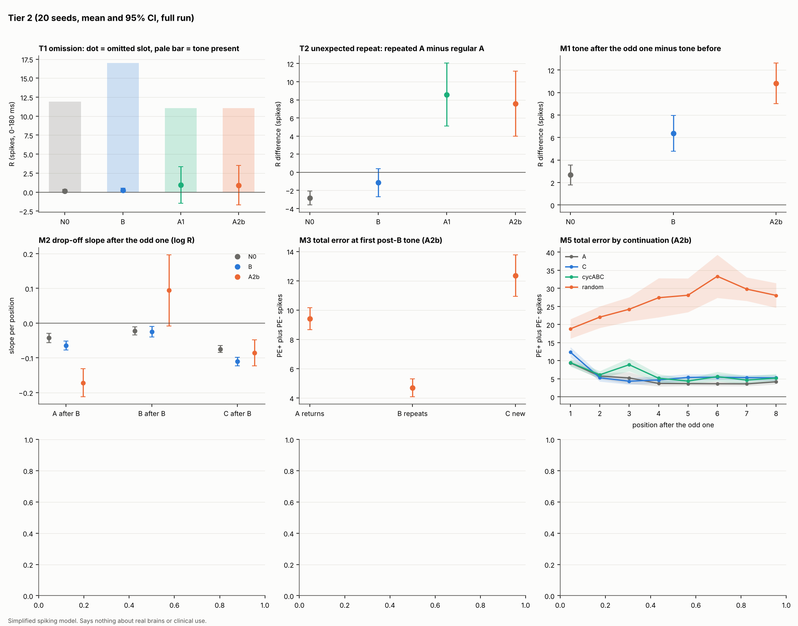

## Abstract

Neurons in the auditory system respond more strongly to a rare "deviant" tone than to a frequent "standard". A
long-running question is how much of this comes from simple adaptation (neurons getting less responsive to what they
have just heard) and how much from prediction (the brain signalling that the input did not match what it expected).
I compare these explanations in a small, fully reproducible spiking neural network (100 excitatory and 20 inhibitory
leaky integrate-and-fire neurons). All predictions and pass rules were written down before each experiment was run, and
every result is reported, including the ones that went against my predictions.
**(1)** Adaptation alone, in this network, explains the deviant-versus-standard difference entirely as repetition
suppression. Short-term synaptic depression gives a stimulus-specific adaptation (SSA) index of 0.19 [0.18, 0.20],
but the prediction-error component is indistinguishable from zero (−0.000 [−0.011, 0.011]) and there is no response to
an omitted tone. This null holds when adaptation is made ten times slower.
**(2)** I then ask what is the smallest addition that produces two signatures that adaptation cannot: a larger
response to an unexpected repeat in an alternating sequence (ABAB**AA**), and a response to a missing tone. A
predictive-coding core (delay line, learned predictions, positive and negative error cells, a simplified version of
Wacongne et al., 2012) produces both only after long training. My proposed addition, a *mismatch gate* that briefly
speeds up learning, raises sensory gain and opens candidate predictions after a surprise, produces both at normal
training (unexpected repeat +7.57 [3.98, 11.15] spikes against −2.84 [−3.62, −2.07] for adaptation alone).
Ablations show error cells, learning and the gate are all needed. Four of my more specific predictions were not
supported, including one-shot learning and a steady build-up of the omission response with regularity. The gated
mechanism's main effects disappeared when adaptation was made slower without re-tuning. Re-tuned by the original
sanity rules (a 15% change to three weights), they return at τ_w = 1000 ms (repeat +6.75 [2.95, 10.55], omission
4.98 [3.09, 6.88]); at τ_w = 3000 ms only a weak repeat effect returns and the omission effect does not. Follow-up
experiments show that the gated network learns about as fast as an ideal Bayesian learner, while the core is about 8
times slower. In random input, however, it makes over-confident guesses, and a simple global precision mechanism added to
fix this silenced all error and failed. The result is therefore a
sufficiency result in a toy model: the gate makes learning faster, not something the predictive core cannot do. It
says nothing about real brains.

## 1. Introduction

The *oddball* paradigm plays a frequent tone (the standard) with a rare different one (the deviant). Neurons respond
more to the deviant. In single neurons this is called stimulus-specific adaptation (SSA); in the EEG, the mismatch
negativity (MMN). Two families of explanation compete:

- **Adaptation.** Neurons tuned to the standard have fired a lot and are tired, so the deviant, which drives fresher
  neurons, gets a bigger response. May & Tiitinen (2010) argued that synaptic habituation can account for the MMN, and
  computational models reproduce SSA from adaptation alone (Mill et al., 2011; Yarden & Nelken, 2017).
- **Prediction error.** The brain learns a model of the sequence and responds to what it did not predict.
  Wacongne, Changeux & Dehaene (2012) built a spiking predictive-coding model that reproduces the MMN, a response to an
  *unexpected repeat* in an alternating sequence, and a response to an *omitted* tone. A purely stimulus-specific
  adaptation account predicts the opposite for the repeat (a *smaller* response, since the repeated tone was just heard)
  and nothing at all for an omission (no input, no response).

Parras et al. (2017) made this distinction measurable in single neurons. With a *many-standards* control (the target
tone at the same probability among many tones) and a *cascade* control (the same tones in a predictable ascending
run), the deviant-minus-standard response splits into **repetition suppression** (iRS = control − standard) and a
**prediction-error** part (iPE = deviant − control). They found iPE grows along the auditory hierarchy (see also the
review by Carbajal & Malmierca, 2018, and Ruhnau, Herrmann & Schröger, 2012, on control choice).

This project asks two questions in one small network where every part can be switched on and off:

1. **What does adaptation alone explain?** I implement two adaptation mechanisms separately and apply the
   Parras-style decomposition.
2. **What is the smallest mechanism that must be added** to produce an unexpected-repeat response and an omission
   response? I compare a slow predictive-coding core with my proposed *mismatch gate* and ablate the gate's parts.

**Contributions.** (i) A reproducible, open spiking model in which adaptation and prediction mechanisms are tested
separately under pre-registered predictions. (ii) A clean negative result: in this network adaptation of either kind,
fast or slow, produces SSA but no prediction-error component and no omission response. (iii) A proposed surprise-gated
mechanism, with ablations, a robustness sweep over its constants and an honest list of what it does not do.

**Relation to prior work.** Surprise-modulated learning rates are well established (Yu & Dayan, 2002; Faraji,
Preuschoff & Gerstner, 2018; Liakoni et al., 2021), including Bayesian models of the MMN (Lieder et al., 2013) and a
spiking network with a surprise-gated three-factor rule (Barry & Gerstner, 2024). Holding several sequence predictions
at once has also been modelled, in spiking sequence networks (Bouhadjar et al., 2022) and as competing interpretations
of sound sequences (Mill et al., 2013). Other network models produce omission responses (Chien, Maess & Knösche, 2019).
In a search of about 30 queries (not a systematic review; `docs/NOVELTY_CHECK.md`), I did not find a spiking model in
which a single mismatch gate jointly boosts plasticity, raises sensory gain and opens several candidate predictions,
tested on oddball, unexpected-repeat and omission paradigms. I present that combination, not its parts, as the
contribution.

## 2. Methods

All code, parameters and pre-registrations are in the repository. Simulations use Brian2 2.10.1.
Every random draw is seeded, so re-running a command reproduces identical numbers.

### 2.1 Network

![**Figure 1. Model.** The Experiment 1 network (N0) is the tone input, the sensory E cells with switchable adaptation, and an inhibitory pool. The predictive core (B) adds a tapped delay line (T), prediction cells with learned weights (L) and positive and negative error cells (E). PE+ fires when input exceeds the prediction and teaches the weights; PE− fires when a prediction is not met by input. Mechanism A adds the mismatch gate (G), driven by PE+, which raises the learning rate and sensory gain and (in A2b) turns on candidate predictions (C).](fig_model.svg){width=95%}

**Sensory network (N0).** Ten tone channels, each with 10 excitatory leaky integrate-and-fire (LIF) neurons
(100 E cells), and one shared pool of 20 inhibitory cells providing feedback inhibition. Each channel receives 20
Poisson input units firing at 100 Hz during a 50 ms tone, with Gaussian tuning (width 0.7 channels, so neighbours get
36% of full weight). Membrane time constant 20 ms, threshold −50 mV, current-based synapses. There are no recurrent
excitatory connections. Four constants (noise, input weight, E→I weight, depression utilisation) were calibrated
against sanity targets written down beforehand: spontaneous rate 1–5 Hz, an unadapted evoked response of 20–60 spikes
per channel, and inhibitory cells active but below 30 Hz. They were never tuned to an experimental outcome.

**Adaptation**, switchable, giving four conditions (none, SFA, depression, both):

- *Spike-frequency adaptation (SFA):* each spike adds 2 mV to an adaptation current that decays with τ_w = 300 ms.
- *Short-term depression:* Tsodyks–Markram-style depression on the input synapses (utilisation 0.1, recovery
  500 ms, no facilitation).

**Predictive core (B).** For each predictive channel: a *tapped delay line* (T; 20 lags of 50 ms, which
lets the network know when a tone happened), *prediction cells* P driven by the delay line through plastic weights (L),
and *positive and negative error cells* (E). PE+ is excited by the sensory cells and inhibited by P. PE− is excited by P
and inhibited by the sensory cells. Weights from the delay line to P grow when PE+ is active while the delay cell
carries an eligibility trace, so errors teach and fully predicted tones cause no learning. B is a simplified,
loosely Wacongne-style network, **not** a replication: LIF instead of Izhikevich neurons, 10-cell instead of 40-cell
populations, a tapped delay line instead of a synfire chain, and no NMDA currents.

**Mechanism A (the proposal).** A *mismatch gate* G jumps with each PE+ spike, decays over 1.5 s and is cut
by "match" cells that need both sensory input and a prediction. While the gate is up it (i) multiplies the
learning rate by 3, (ii) raises the gain of the input synapses (sensitisation), and, in variant **A2b**, (iii) turns on
three *candidate predictions*: the tone that just caused the error repeats, the earlier tone returns, or something new
appears. Variant **A1** replaces the candidates with faster forgetting of old predictions. A adds about 13 constants to
the roughly 25 of the core. Gate constants were calibrated on development seeds (100–104) against sanity targets, for
example that the gated learner predicts a new pair within about three exposures without large over-prediction. Test
seeds were separate.

### 2.2 Experiments and measures

**Experiment 1 (adaptation alone).** Oddball blocks of 400 tones (deviant probability 0.1, standard on channel 3,
deviant on channel 6, inter-stimulus interval 300–500 ms) in a flip-flop design, plus many-standards and cascade
controls matched in target probability. The response is the baseline-corrected spike count of the 10 cells of the
target channel in 0–180 ms after onset (window from Parras et al., 2017). From these I compute the SSA index
(D − S)/(D + S) and the normalised decomposition iMM = iRS + iPE. Sweeps cover frequency gap (1–6 channels) and deviant
probability (0.05–0.3). Omission blocks drop tones from a regular sequence. Pre-registration: `docs/PREREGISTRATION.md`.

**Experiment 2 and Tier 2 (what must be added).** All with both adaptation mechanisms on and a fixed 450 ms
tone-to-tone interval, comparing N0, B, A1 and A2b:

- **T1 omission.** Tone A repeated, 20% of tones omitted. Measure (v3, see §2.3): PE− spikes at omitted slots minus at
  present-tone slots. Pass: 95% CI above 0 and a mean of at least 1 spike.
- **T2 unexpected repeat.** ABAB… with 10% of B replaced by A. Measure: response to the repeated A minus the regular A.
- **M1, the tone after the odd one.** Episodes A×(6–9), B, then a continuation. Measure: the first A after B minus the
  last A before it, compared against N0.
- **M2, M3, M5:** drop-off slopes, error and gate when the continuation fits a candidate, and continuation types
  including a random one.
- **One-shot learning, regularity build-up (1, 2, 4, 8 regular tones before an omission), timing jitter (0–60% of the
  interval)**, an **ablation** over subsets of {T, E, L, G, C}, a **robustness** sweep (40 random draws of A2b's
  constants), and a **long-training** fairness check for B (600 instead of 160 slots).

**General pass rule:** the 95% CI over seeds excludes 0 and the effect is at least 10% of the reference response.
Statistics: 20 seeds per condition (a seed fixes connectivity and noise); mean and Student-t 95% confidence interval
over seeds, paired within seed.

### 2.3 Pre-registration and deviations

Each experiment's design, measures and predictions were committed before it ran (`docs/PREREGISTRATION.md`,
`docs/PREREGISTRATION_TIER2.md`). Every change made after a run is listed in a change log there. The most important:
the pre-registered omission measure subtracted a 75 ms pre-tone baseline. In the gated networks the prediction cells
fire *before* the expected tone, so the baseline already contained the omission response and subtracting it cancelled
the effect. I replaced it with a raw omitted-minus-present contrast (v3) and wrote it down before re-running. I had
inspected spike traces from one test seed while diagnosing the problem, so **the omission result is reported as
exploratory**. The superseded numbers are archived in `results/archive/`.

## 3. Results

### 3.1 Adaptation alone produces SSA but no prediction error

{width=100%}

| Adaptation | SSA index | iRS (control − standard) | iPE (deviant − control) |
|---|---|---|---|
| none | −0.000 [−0.006, 0.006] | 0.008 [−0.006, 0.021] | −0.008 [−0.020, 0.005] |
| SFA | 0.019 [0.012, 0.026] | 0.009 [−0.005, 0.023] | 0.011 [−0.003, 0.025] |
| depression | 0.161 [0.153, 0.169] | 0.178 [0.165, 0.191] | −0.006 [−0.016, 0.004] |
| both | 0.187 [0.178, 0.195] | 0.198 [0.186, 0.209] | −0.000 [−0.011, 0.011] |

: **Table 1.** Experiment 1, normalised indices, cascade control, p = 0.1, gap 3 channels.

Short-term depression accounts for almost all of the deviant-versus-standard difference, and all of it is
repetition suppression (Fig. 2a, b). The prediction-error component is zero in every condition, with CI half-widths
around 0.01–0.015, so effects bigger than about 0.015 would have been detected. The many-standards control gives the
same. There is no omission response (at most 0.21 spikes, against 11–26 spikes for a present tone; Fig. 2c). The
"both" condition's CI just excludes 0, but the effect is 1.8% of the tone response, well below the 10% floor.

**A prediction that failed.** I predicted SSA would fall with deviant probability and rise with frequency gap,
as in recordings. It is flat across both (Fig. 2d, e). The reasons lie in the architecture: depression is private to
each input channel, and adaptation recovers within the gap between tones, so the standard's state does not depend on
how rare the deviant is. Models with slower or multi-timescale adaptation reproduce this dependence (Mill et al., 2011;
Yarden & Nelken, 2017), so this is a limitation of my network, not a finding.

**Sensitivity to slower adaptation.** SFA explains little at τ_w = 300 ms because it decays before the next tone.
I re-ran with τ_w = 1000 and 3000 ms (labelled exploratory). SSA from SFA alone grows from 0.02 to 0.12 and 0.34, but
iPE stays at about 0 (all CIs within ±0.03). **Slower adaptation makes the mismatch response bigger, but all of the
increase is repetition suppression.**

### 3.2 What has to be added

{width=100%}

| Test | N0 (adaptation) | B (predictive core) | A1 | A2b | Verdict |
|---|---|---|---|---|---|
| T2 unexpected repeat (repeat − regular) | −2.84 [−3.62, −2.07] | −1.15 [−2.69, 0.39] | +8.58 [5.09, 12.07] | +7.57 [3.98, 11.15] | A passes; N0 shows the adaptation sign |
| T1 omission, PE− omitted − present (v3) | 0 | 0.14 [−0.07, 0.34] | 5.66 [3.83, 7.49] | 5.97 [3.80, 8.15] | A passes (exploratory) |
| B with long training (600 slots) | | repeat +5.84 [2.15, 9.52]; omission 2.76 [1.48, 4.03] | | | B passes too |
| M1 tone after the odd one (post − pre) | 2.68 | 6.36 | 11.70 | 10.83; vs N0 +8.15 [5.78, 10.52] | Supported; B also above N0 |

: **Table 2.** Main Tier 2 results (spikes; mean [95% CI]).

**Unexpected repeat.** Adaptation alone gives the opposite sign: the repeated tone gets a *smaller* response, as a
stimulus-specific adaptation account predicts. Both gated variants reverse it with large effects. The predictive core B
fails at normal training. **With long training it passes both tests**, so the gate's contribution is *speed of learning*,
not an ability the core lacks.

**Omission.** With the v3 measure, A1 and A2b show about 6 extra negative-error spikes at omitted tones. B shows this
only with long training, and N0 has no error cells. Part of this is structural, because PE− cells are built to be
silenced by input. The more informative result is that the response **falls as timing gets irregular** (5.97, 5.61, 4.38,
3.23 spikes for jitter 0, 0.1, 0.3, 0.6 of the interval; Fig. 3, bottom right), as a timing-based prediction should.

**Tone after the odd one (M1).** The first standard after a deviant is amplified well beyond adaptation's recovery
rise (A2b − N0 = 8.15 [5.78, 10.52]), and this effect survives every check in this paper. B shows a smaller version
(3.68 [2.05, 5.31] above N0), so it is not unique to the gate. About 2.6 spikes of A's effect is sensitisation in the
sensory cells, which the gate does by design. **This is a model prediction, not a match to data.** Evidence from real
recordings is mostly negative: EEG studies report no N1 enhancement (Rosburg & Mager, 2021) and no MMN-like effect
(Coy et al., 2024) for standards after deviants, and intracellular recordings show the first standard after a deviant
only slightly larger (Hershenhoren et al., 2014). If the size of the effect here were found in recordings, it would
support a gain mechanism; current evidence suggests real circuits do not show it at this strength.

**Candidate fit (M3).** After a deviant, total error is lower when the next tone fits a candidate (earlier tone
returns: 9.40; deviant repeats: 4.69) than when it is new (12.35), and so is the gate level (0.37, 0.40 vs 0.46).
The error ordering also appears in B; the gate ordering is specific to A.

**Ablation.** Both tests pass only with error cells, learning and the gate together (subsets TELGC, TELG, ELGC). The
repeat alone needs only error cells plus learning (EL, ELG), and the delay line can be swapped for the candidates.

**Robustness.** Across 40 random draws of A2b's constants (one seed each, effect floor only), omission passes in
82%, the repeat in 75%, and both in 62%.

### 3.3 Predictions that were not supported

| Prediction | Result |
|---|---|
| Steeper response drop-off after the odd one, ordered A > B > C (M2) | Not steeper (−0.17 vs −0.19 initially); order A, C, B |
| One-shot learning: error falls after one exposure | Ratio of pair 2 to pair 1 = 1.11 [0.89, 1.32]; learning takes about 10 exposures |
| Omission response rises steadily with the number of regular tones | Jumps from 1 to 2 tones (+3.54 [1.71, 5.38]), then flat |
| Error in a random sequence decays as randomness is "accepted" (M5) | Does not decay (26.6 → 26.8); no precision mechanism is implemented |
| A's repeat and omission effects survive slower adaptation *without re-tuning* | **No.** Repeat +1.10 [−1.23, 3.43] at τ_w = 1000 ms and −5.74 at 3000 ms; omission 1.02 and 0 (but see §3.4) |

: **Table 3.** Pre-registered or planned predictions that failed.

The gate's constants had been calibrated with τ_w = 300 ms and were not re-tuned for that sensitivity run. The next
section tests whether re-tuning brings the effects back. M1 survives at both slower values even without re-tuning.

### 3.4 Re-tuning for slower adaptation

To separate "the mechanism needs fast adaptation" from "the circuit was mis-calibrated", I re-tuned it at
τ_w = 1000 ms using the original sanity targets (`docs/RETUNE_SLOW_ADAPTATION.md`, committed before any run at the new
value). The procedure has three steps:

- **Targets.** Seven sanity targets, for example "an unpredicted tone drives the positive-error cells to 60–100% of
  the sensory response" and "the gated learner predicts within about 3 exposures". They are measured on development
  seeds only, and none of them uses an omission, a repeat or a post-deviant tone.
- **Check at the original setting.** I first confirmed that the original constants meet all seven targets at 300 ms.
  Two ranges had to be widened slightly to match the original "about" wording; this is logged.
- **Search.** A fixed grid of 36 candidate settings. The rule picks the candidate meeting the most targets and, among
  ties, the smallest change.

At 1000 ms the original constants miss three targets: the error cells respond too weakly, and the gated learner is too
slow. Twelve candidates meet all seven. The rule selects a **15% increase of the three weights driven by the sensory
cells**, with the learning constants unchanged.

| net | unexpected repeat | omission (PE− omitted − present) | M1 minus N0 |
|---|---|---|---|
| N0 | −3.38 [−4.00, −2.76] | 0 | |
| B | −3.51 [−4.54, −2.47] | 0.05 [−0.03, 0.13] | 4.35 [2.71, 5.98] |
| A1 | +7.71 [3.61, 11.81] | 4.36 [2.69, 6.03] | 6.96 [4.07, 9.85] |
| A2b | +6.75 [2.95, 10.55] | 4.98 [3.09, 6.88] | 6.79 [4.16, 9.42] |

: **Table 4.** Tier 2 at τ_w = 1000 ms after re-tuning (20 test seeds).

All pre-stated predictions hold. Adaptation alone keeps the wrong sign on the repeat. Both gated variants pass the
repeat and omission tests with effects close to those at 300 ms. The re-tuned core B still fails at normal training.
**The earlier failure was a calibration mismatch, not a dependence on fast adaptation.** Caveats: I had seen the untuned
results before designing this; only the selected candidate was tested; and the test seeds are the same as before.
At τ_w = 3000 ms (secondary), the original constants meet only 2 of 7 targets and only 3 candidates meet all seven
(selected: sensory-driven weights +30%, slow learning rate doubled). After re-tuning, the unexpected repeat passes but
only just (A2b +3.75 [0.01, 7.49]; A1 +4.19 [0.52, 7.85]), and **the omission test fails** (A2b 0.56 [0.19, 0.93],
below the 1-spike floor). The mechanism therefore tolerates threefold slower adaptation but degrades at tenfold.

### 3.5 Follow-up experiments: ideal observer, error definitions and precision

Three further experiments were pre-registered after the main results (`docs/PREREGISTRATION_EXP13_15.md`,
`docs/PREREGISTRATION_EXP9.md`) and run on the same 20 test seeds.

**Benchmark against an ideal learner (supported).** A Bayesian learner that predicts each tone from the previous one
(uniform prior over the four tones, perfect memory) needs 6 exposures to learn the alternation A B A B. With the same
criterion, A2b needs 5.10 [4.23, 5.97] and the core B 49.4 [38.3, 60.5], about 8 times the ideal. A2b is slightly faster
than the ideal learner only because its candidates build in a bias towards "the tone repeats" or "the earlier tone
returns", which fits an alternation; the ideal learner starts without that bias. Tone by tone, the network's error
rises with the ideal learner's surprise, but weakly (Spearman r 0.16 [0.09, 0.23] for A2b, 0.15 for B), while adaptation
alone goes the other way (−0.17). In a random sequence, the ideal learner's surprise also stays at chance (about 2 bits),
so failing to reduce error there (M5) is partly what any learner does.

**Two definitions of error (one prediction failed).** I compared a subtractive error, E1 = 1 − p(event), with my own
definition, E2 = p(top guess) − p(event), which is zero when the prediction is flat. Both were read from the prediction
cells before each tone. Both rise sharply for the unexpected repeat. In a random sequence E1 stays at 0.74, as
predicted. But E2 is 0.27 [0.24, 0.29], not near zero as I had predicted, although the ideal learner's E2 is 0.08. **The
network keeps making confident guesses in random input**; an ideal learner spreads its prediction out.

**Precision (failed).** I added one slow variable that tracks recent error and turns down the gain of all error cells.
No setting met both calibration targets, because the gain came out almost the same in regular and random contexts.
In the tests it lowered error everywhere, so that error per tone was about 1.7 in both contexts. It showed no
context-dependent deviant response, and it **destroyed the main results** (unexpected repeat −3.88, omission 0). A
single global precision signal acts as gain control: it silences the errors the network needs in order to learn.
Making precision specific to context, for example per channel or driven by how reliable predictions have been, is a
redesign left for future work.

## 4. Discussion

**What this shows.** In this network, adaptation, whether fast or slow, synaptic or intrinsic, produces a large
deviant-minus-standard difference made entirely of repetition suppression. The Parras decomposition finds no
prediction-error component, and there is no omission response. Getting an unexpected-repeat response and an omission
response requires error cells and learned, timed predictions. A slow predictive core gets there with enough training.
A surprise gate that briefly boosts learning, sensitises input and offers candidate predictions gets there within
normal training.

**What it does not show.** This is a sufficiency result in a toy network: these mechanisms *can* produce these
signatures here. It does not show that brains use them, and nothing here bears on clinical use. Several parts of the
predictive circuit (delay lines, separate error populations, candidate drives) are designed structures. The gated
effects need the circuit to be calibrated for the adaptation level it runs with, and at very slow adaptation
(3000 ms) the omission effect is lost even after re-tuning (§3.4).

**Relation to work on learning.** The gate is a form of surprise-modulated learning rate, an idea with precedent
in both neuroscience and machine learning (Yu & Dayan, 2002; Faraji et al., 2018; Liakoni et al., 2021; Barry &
Gerstner, 2024). The finding
that the gate changes *how fast* rather than *whether* a sequence is learned matches that framing: surprise is a
signal for when to update quickly. Error in a random sequence never settled, and the network's guesses there are
over-confident compared with an ideal learner (§3.5). So a gate alone is not enough: a system also needs an estimate of
how predictable its input is (precision). My first, global version of precision failed by silencing all error, which
suggests precision has to be specific to what is being predicted.

**Limitations.** One small architecture with single a-priori time constants; deviants only above the standard; weak
feedback inhibition (inhibitory cells fire about 3 Hz); spike counts rather than an EEG-like signal; one 10-cell
channel per tone rather than distributed coding; the omission measure revised after a first run; robustness tested
with one seed per draw; and several cited works read only at abstract level (marked in `docs/PRIOR_ART.md`).

**Next steps.** (1) Test all candidate settings that meet the targets, not only the selected one. (2) Redesign precision so it is specific to each channel or tied to prediction reliability, and test whether error in random contexts then falls without losing the main results.
(3) Compare learning speed against an ideal Bayesian observer. (4) Test whether the post-deviant gain is reduced
to the small effect seen in recordings, and what that costs the other tests. (5) Extend the literature search to a
systematic review and read the key papers in full.

## Reproducibility

```
make setup && make test    # pinned dependencies, unit tests (about 3 min)
make fig1-quick            # Experiment 1, 5 seeds (about 10 min on 4 cores)
make fig2-quick            # Tier 2, 5 seeds (about 1 h on 4 cores)
make fig1 && make fig2     # full 20-seed runs (hours, resumable)
```
Results are cached by a hash of each block's specification, so interrupted runs resume. The tests check, among other
things, the LIF firing rate against the analytic value, determinism under a fixed seed, and the decomposition arithmetic.

## References

*Verification levels follow `docs/PRIOR_ART.md` and `docs/NOVELTY_CHECK.md`: \[F\] full text read; \[A\] abstract
or bibliographic record; \[S\] search-result summary only. Every \[S\] entry must be checked against the publisher's page
before submission.*

- Barry, M. L. L. R. & Gerstner, W. (2024). Fast adaptation to rule switching using neuronal surprise. *PLoS
  Computational Biology*, 20(2), e1011839. doi:10.1371/journal.pcbi.1011839 \[S\]
- Bouhadjar, Wouters, Diesmann & Tetzlaff (2022). Sequence learning, prediction, and replay in
  networks of spiking neurons. *PLoS Computational Biology*. PMC9273101. \[S; initials, volume and article number to
  be checked\]
- Carbajal, G. V. & Malmierca, M. S. (2018). The neuronal basis of predictive coding along the auditory pathway: from
  the subcortical roots to cortical deviance detection. *Trends in Hearing*, 22. doi:10.1177/2331216518784822 \[F\]
- Chien, V. S. C., Maess, B. & Knösche, T. R. (2019). A generic deviance detection principle for cortical On/Off
  responses, omission response, and mismatch negativity. *Biological Cybernetics*, 113(5–6), 475–494.
  doi:10.1007/s00422-019-00804-x \[S\]
- Coy, N., Bendixen, A., Grimm, S., Roeber, U. & Schröger, E. (2024). Conditional deviant repetition in the oddball
  paradigm modulates processing at the level of P3a but not MMN. *Psychophysiology*, 61(6), e14545.
  doi:10.1111/psyp.14545 \[S\]
- Faraji, M. J., Preuschoff, K. & Gerstner, W. (2018). Balancing new against old information: the role of puzzlement
  surprise in learning. *Neural Computation*, 30(1), 34–83. doi:10.1162/NECO_a_01025 \[S\]
- Hershenhoren, I., Taaseh, N., Antunes, F. M. & Nelken, I. (2014). Intracellular correlates of stimulus-specific
  adaptation. *Journal of Neuroscience*, 34(9), 3303–3319. doi:10.1523/JNEUROSCI.2166-13.2014 \[S\]
- Liakoni, Modirshanechi, Gerstner & Brea (2021). Learning in volatile environments with the Bayes
  factor surprise. *Neural Computation*, 33(2), 269–340. \[S; initials to be checked\]
- Lieder, Daunizeau, Garrido, Friston & Stephan (2013). Modelling trial-by-trial changes in
  the mismatch negativity. *PLoS Computational Biology*, 9(2), e1002911. \[S; initials to be checked\]
- May, P. J. C. & Tiitinen, H. (2010). Mismatch negativity (MMN), the deviance-elicited auditory deflection,
  explained. *Psychophysiology*, 47(1), 66–122. \[A\]
- Mill, R. W., Bőhm, T. M., Bendixen, A., Winkler, I. & Denham, S. L. (2013). Modelling the emergence and dynamics of
  perceptual organisation in auditory streaming. *PLoS Computational Biology*, 9(3), e1002925. \[S\]
- Mill, R., Coath, M., Wennekers, T. & Denham, S. L. (2011). A neurocomputational model of stimulus-specific adaptation
  to oddball and Markov sequences. *PLoS Computational Biology*, 7(8), e1002117. \[A\]
- Parras, G. G., Nieto-Diego, J., Carbajal, G. V., Valdés-Baizabal, C., Escera, C. & Malmierca, M. S. (2017). Neurons
  along the auditory pathway exhibit a hierarchical organization of prediction error. *Nature Communications*, 8, 2148.
  doi:10.1038/s41467-017-02038-6 \[F\]
- Rosburg, T. & Mager, R. (2021). *Hearing Research*, 400, 108140. \[S; title to be checked\]
- Ruhnau, P., Herrmann, B. & Schröger, E. (2012). Finding the right control: the mismatch negativity under
  investigation. *Clinical Neurophysiology*, 123(3), 507–512. doi:10.1016/j.clinph.2011.07.035 \[A\]
- Wacongne, C., Changeux, J.-P. & Dehaene, S. (2012). A neuronal model of predictive coding accounting for the
  mismatch negativity. *Journal of Neuroscience*, 32(11), 3665–3678. doi:10.1523/JNEUROSCI.5003-11.2012 \[F\]
- Yarden, T. S. & Nelken, I. (2017). Stimulus-specific adaptation in a recurrent network model of primary auditory
  cortex. *PLoS Computational Biology*, 13(3), e1005437. \[A\]
- Yu, A. J. & Dayan, P. (2002). Expected and unexpected uncertainty: ACh and NE in the neocortex. *Advances in
  Neural Information Processing Systems 15*, 173–180. \[S; author order to be checked: the NeurIPS listing may put
  Dayan first, in which case cite as Dayan & Yu (2002)\]

Software: Brian2 2.10.1 spiking neural network simulator (briansimulator.org).
